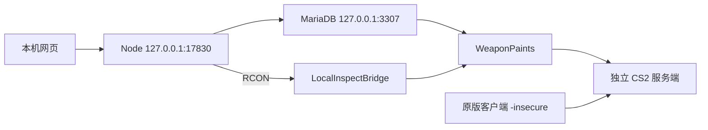

# 结构与关键实现

浏览器访问本机 Node 后台。Node 写入独立 MariaDB，再通过本机 RCON 调用 LocalInspectBridge。扩展等待 WeaponPaints 读取配装数据后，仅更新所选装备槽位并核对持有视角。

## 为什么复制客户端能开服务端

当前 Steam CS2 安装同时含客户端与服务端组件，`game\bin\win64\cs2.exe -dedicated` 可使用服务端模式。复制创建的是一套独立文件，再只在副本中安装 Metamod 和 CSS 插件。原版文件不需要加入插件。游戏更新后两套文件需要保持版本兼容。

## 保留本次修复

- 不再执行两次 `wp_refresh`；应用请求由前端锁定，后台串行处理，通过任务 ID 防止重复受理。
- `LocalInspectBridge` 先等待 `GetPlayerData` 完成，再更新武器，避免数据库读取与刷新竞争。
- 枪械按 defindex 发放，只替换相应槽位；刀具替换刀，手套保持原武器。定时检查 ActiveWeapon，必要时尝试恢复原槽位。
- 使用 `inspect_apply / inspect_result`，后台等实际结果再反馈；`inspect_ready / inspect_inventory / inspect_plan` 供只读诊断。
- 自有命令仅接受控制台来源和配置中的本机 SteamID，不给其他玩家开放。
- Node 的 RCON 命令排队，避免状态轮询和应用同时建立连接造成偶发失败。
- 网页令牌保存在本机 secrets.json，令牌过期会重新获取后重试一次；仍保留 Host、Origin 校验和 CSP。
- `sv_infinite_ammo 2` 保留正常换弹。
- `mp_warmup_online_enabled 0`、`mp_warmup_offline_enabled 0` 关闭热身；配合 `mp_warmup_pausetimer 0`、`mp_warmuptime 0` 和 `mp_warmup_end`。`sv_warmup_to_freezetime_delay 0` 在当前引擎被限制为最小值 3；正常关闭热身时不应进入热身结束过渡。

## 搭配组合

`outfit-groups.mjs` 管理 `data/outfit-groups.json`。首次运行时将旧 `presets.json` 按保存顺序迁入默认组合，保留重复项并生成条目 ID。组合文件先写临时文件再重命名；默认组删除保护、组名校验和删除确认同时由后台执行，保存接口必须指定组合。

整组应用先校验全部条目，同一武器 defindex、刀具和手套分别取最后保存的方案，再在一个数据库事务中写入 T/CT 两队。提交完成后，按主武器、手枪、电击枪、刀具、手套各槽位的最终选择串行调用定向应用；手套最后更新以保留最终持有视角。不同枪械皮肤均保存，同槽位只发放最终选中的一把。

批次共用应用锁，期间拒绝其他应用和服务启停请求；某个槽位刷新失败时停止后续刷新并报告未全部完成。事务失败不会发送装备更新。旧版 POST `/api/presets` 拒绝保存并提示刷新页面，避免产生组合外的条目。

## 网页与图片

前端：原生 HTML/CSS/JavaScript，无打包工具；后端：Node 原生 HTTP、mysql2、自带 RCON 客户端。npm 锁文件固定依赖解析结果。首次安装使用 npm ci 并禁用安装脚本。

饰品数据来自已安装 WeaponPaints 的中文 JSON。图片使用库中现有的公共 URL，仅允许固定 GitHub 仓库路径的 PNG。浏览器只访问本机 `/images/<def>/<paint>.png`。

图片缓存最大 4 个下载并发、相同请求合并、15 秒超时，检查 PNG 标头、尺寸和 4 MiB 大小上限。缓存先写临时文件再重命名，放在部署目录的 `data\preview-images`。后端没有接收任意远程 URL 的下载接口。普通下载错误暂缓 30 秒，404 暂缓 1 小时；显式重试可再获取。列表使用延迟加载，不一次下载全部 2161 张。

## 可迁移路径

地图白名单及中文名称位于 `runtime/web/maps.mjs`。启动脚本通过 `-Map` 参数接收选择，Node 与 PowerShell 都校验白名单；未指定时使用 `de_dust2`。运行时 POST `/api/map` 发送一次 `changelevel`，按 `status` 中已加载的主地图确认结果，完成后重新执行 `inspect_server.cfg`。切图期间与装备应用、启停操作互斥，RCON 因切图断开时等待状态恢复，不重复发送切图命令。

地图图标来自 [MurkyYT/cs2-map-icons](https://github.com/MurkyYT/cs2-map-icons)，属于 Valve 游戏素材。十张 PNG 和来源校验清单随仓库部署，通过本机白名单路由提供，不接受任意文件路径或外部图片地址。

PowerShell 从自身 `scripts` 的上级推导安装根目录，Node 从 `web/paths.mjs` 推导；Steam 路径与临时目录读 `data/settings.json`。LocalInspectBridge 从自己的 ModuleDirectory 向上定位同一安装的 data/profile.json。

端口仍固定为 17830 / 3307 / 27015，协议和防火墙规则名也固定。这是单机单实例设计。移动已部署目录后需要重新生成 mariadb.ini，并重新配置防火墙和协议；推荐在新位置重新部署。

## 运行文件快照

对照发布包按安装顺序覆盖后，共核对 744 个第三方文件；唯一差异是 CSS 的 gamedata.json 中 Linux 的 ClientPrint 签名，Windows 部分未变。为保留实际运行基线，仓库记录该文件完整快照及 SHA256，安装时在解压后复制。它不是额外的 Windows 修复；未来升级 CSS 时需要一并重新评估这个快照，避免旧覆盖文件覆盖新版本 gamedata。

## 第三方来源

- [WeaponPaints build-472](https://github.com/Nereziel/cs2-WeaponPaints/releases/tag/build-472)：饰品数据、图片来源和配装插件；`runtime/web/schema.sql` 由其表结构整理，保留 [GPL-3.0 许可](LICENSE-WeaponPaints.txt)。
- [CounterStrikeSharp v1.0.380](https://github.com/roflmuffin/CounterStrikeSharp/releases/tag/v1.0.380)：C# 插件接口与运行时；许可见 [上游 LICENSE](LICENSE-CounterStrikeSharp.txt)。
- [Metamod:Source](https://www.sourcemm.net/downloads.php?branch=master)：服务端插件加载器。
- [AnyBaseLib](https://github.com/NickFox007/AnyBaseLibCS2/releases/tag/0.9.4)、[PlayerSettings](https://github.com/NickFox007/PlayerSettingsCS2/releases/tag/0.9.4)、[MenuManager](https://github.com/NickFox007/MenuManagerCS2/releases/tag/1.4.1)：上游依赖。
- [MariaDB 11.4.13 归档](https://archive.mariadb.org/mariadb-11.4.13/winx64-packages/) 与 [Node 24.22.3](https://nodejs.org/dist/v24.22.3/)：便携运行程序。

上游程序和素材的许可仍归各自项目；安装器只校验、解压用户获得的发布包。游戏本体由 Steam 提供，不加入 Git。仓库当前作为个人本地部署备份，没有发布到远端。
